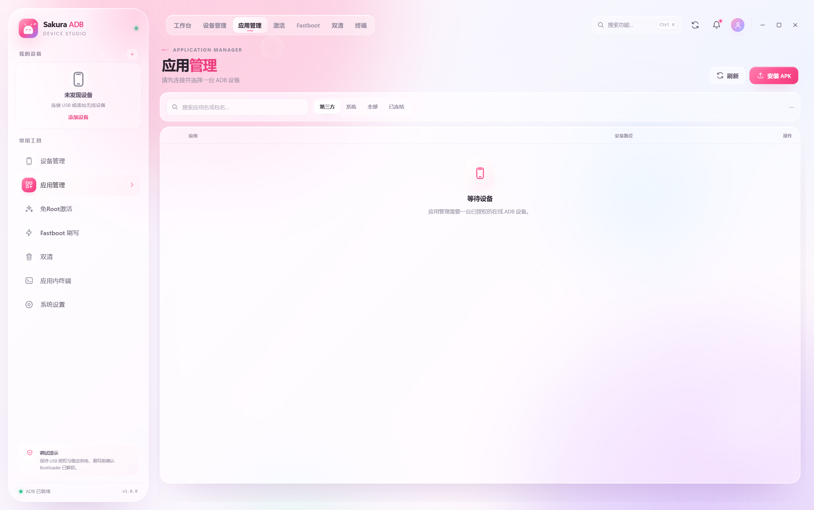
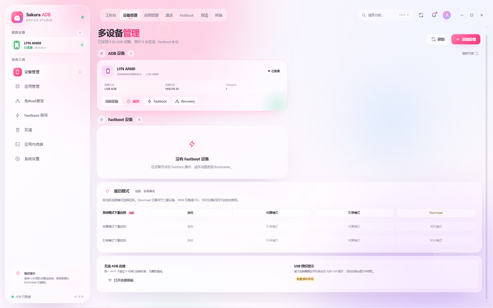
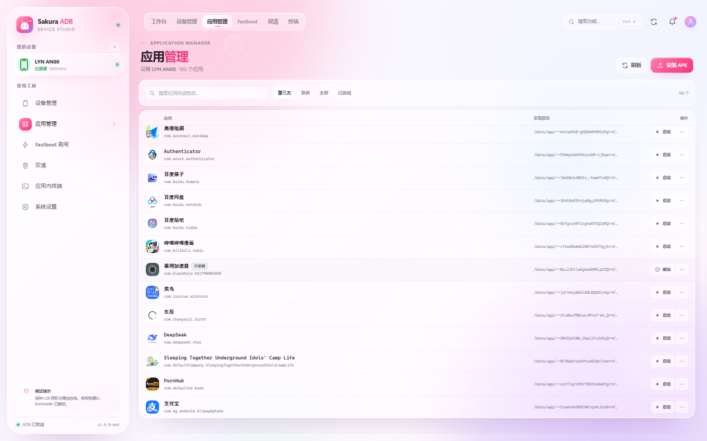

# Sakura ADB Toolbox

> 樱花粉紫液态玻璃风格的 Windows Android 工具箱。直接调用本机 ADB / Fastboot，管理多台设备、应用、免Root激活、刷写、双清，并在应用内终端执行命令。

[下载最新版本](https://github.com/NAHIDA100/Sakura-ADB-Toolbox/releases/latest) · [MIT License](LICENSE)



⚠️ 警告：本工具涉及系统底层操作，使用前请务必备份重要数据！因操作不当导致的设备变砖、数据丢失，开发者概不负责！
## 下载与运行

GitHub Releases 提供两种 Windows x64 发行版：

| 版本 | 说明 |
| --- | --- |
| **安装版** | Inno Setup 中文安装向导，按当前用户安装到 `%LOCALAPPDATA%\Programs\Sakura ADB Toolbox`，创建桌面/开始菜单快捷方式，带卸载器 |
| **绿色版** | 解压即用，`portable.flag` 让数据保存在程序旁的 `data` 目录，删除文件夹即卸载 |

安装版无需管理员权限。首次运行如果 Windows 提示未知发布者，选择“更多信息 → 仍要运行”。

### 环境要求

- Windows 10/11 x64
- Android platform-tools（`adb.exe` / `fastboot.exe`）
- 手机开启 USB 调试，并在授权弹窗中允许当前电脑

应用会自动检测 PATH、`ANDROID_HOME` / `ANDROID_SDK_ROOT` 和常见 SDK 目录；也可在“系统设置”中手动指定。

### 网页版

仓库同时包含一套共享渲染层的本地网页版：

```bash
node web/launcher.cjs --browser
```

启动器会优先复用已运行的 Sakura 服务；如果 4400 被其他程序占用，会自动从 4401 起寻找空闲端口，并把实际端口写入 `web-data/server.json`。

## 功能

| 模块 | 能力 |
| --- | --- |
| 工作台 | 设备概览、快捷操作、实时日志、CPU/内存/温度/电量/存储监控 |
| 多设备管理 | ADB / Fastboot 双列表、当前设备切换、无线连接/配对/断开、重启 |
| 重启模式 | 系统 / 恢复 / 引导模式矩阵：系统、Recovery、Bootloader、Download、关机、9008 EDL |
| 应用管理 | 真实应用名称与图标、第三方/系统/全部/已冻结筛选、安装、启动、停止、清数据、冻结/解冻、卸载 |
| 免Root激活 | Shizuku、黑阈、绿色守护、冰箱、小黑屋等 11 个项目；安全模式下不自动移除账户/设置设备所有者 |
| Fastboot 刷写 | 镜像 SHA-256、分区选择、FLASH 确认、流式输出、可选刷后重启 |
| 双清 | 用户数据/缓存清理、二次确认、危险操作提示 |
| 应用内终端 | 直接执行 adb / fastboot，自动注入 `-s`，流式输出与停止 |
| 系统设置 | 工具路径检测、版本信息、减少动效、数据目录 |

### 重启矩阵



- 系统模式：系统 / 恢复模式 / 引导模式 / Download
- 恢复模式：系统 / 引导模式 / 恢复模式 / 关机
- 引导模式：系统 / 引导模式 / 恢复模式 / 9008

恢复模式需要该 Recovery 暴露 ADB。若 `adb devices` 为空，应用无法凭空检测；请在 Recovery 中选择「Apply update from ADB」启用 Sideload，或直接重启到系统/Bootloader。部分官方 Recovery 不提供 ADB。

### 应用管理



应用名称和图标由设备端 `PackageManager` 读取。首次使用会在手机上安装一个约 12 KB、无桌面图标的「Sakura 元数据」组件（`web/sakura_appmeta.apk`），读取完成后缓存 10 分钟；不联网。

### 免Root激活

- **Shizuku**：通过 `pm path` 自动解析安装目录，执行 `lib/arm64/libshizuku.so`；Android 11+ 不需要无线调试配对，重启手机后需重新执行。
- **黑阈**：官方 `BreventServer bootstrap` 命令。
- **绿色守护**：安装后可授予 `DUMP` 权限。
- 冰箱、小黑屋、炼妖壶、黑洞、第二空间、安装狮、AirFrozen、FreezeYou：检测安装状态并展示官方步骤；安全模式不会自动清账户或设置设备所有者。

## 开发

要求：Windows 10/11 x64、Node.js 20+、pnpm、Android platform-tools。

```bash
pnpm install
pnpm dev       # Electron 开发模式
pnpm test      # node:test
pnpm dist:dir  # 打包解压目录
```

安装器源码在 `installer/sakura.iss`，需要 Inno Setup 6：

```bat
ISCC.exe installer\sakura.iss
```

### 目录

```text
electron/      主进程、preload、自定义协议、IPC 和领域服务
public/        渲染层 HTML / CSS / ES Modules
web/           本地网页版服务、启动器和应用元数据组件
installer/     Inno Setup 安装脚本
test/          Node 测试
scripts/       图标生成等开发脚本
build/         Windows 图标
docs/          验收截图与 helper 源码
```

## 安全与边界

- 渲染进程启用 `contextIsolation`、关闭 `nodeIntegration`；页面只加载本地协议资源，CSP 禁止远程连接。
- 所有 ADB/Fastboot 命令以参数数组启动，不经过 shell 拼接。
- 默认启用 GPU 渲染；远程桌面或显卡驱动异常时，可用 `Sakura ADB Toolbox.exe --software` 回退软件渲染。
- 不收集设备数据，不发起网络请求，不自动更新。
- 刷写、双清、9008/Download 都有设备风险；请确认 Bootloader、电量、镜像来源和数据备份。
- 应用不包含 Bootloader 解锁功能。

## 已知限制

- 恢复模式是否可用取决于 Recovery 是否提供 ADB；官方 Honor Recovery 可能完全不枚举 USB。
- Download 主要用于三星 Odin；9008 仅适用于高通 EDL，且可能需要已授权 firehose。
- 应用管理只导出 base APK，不打包 split APK。
- 终端不是完整 PTY，不支持 vim、全屏 top 等交互程序。
- 发行版 exe 未做代码签名；企业分发请自行签名。
- 不内置 platform-tools。

## License

[MIT](LICENSE) © 2026 NAHIDA100
